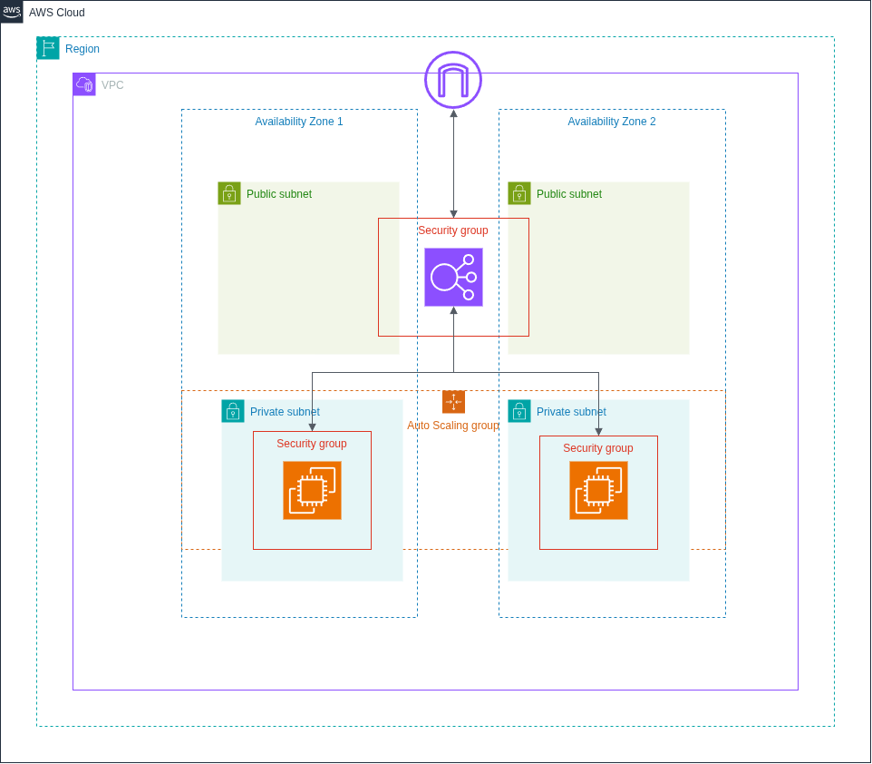

# AWS High Availability Web Infrastructure

## Description

A highly available web infrastructure deployed on AWS using Terraform.

The project provisions an Application Load Balancer (ALB) in public subnets across two Availability Zones, distributing incoming HTTP traffic to EC2 instances running in private subnets.

The EC2 instances are managed by an Auto Scaling Group and serve a simple HTML page using Python's built-in HTTP server.

The infrastructure demonstrates AWS networking, high availability, load balancing, and Infrastructure as Code, with a focus on keeping deployment costs low.

## Architecture



## Infrastructure Overview

The project provisions the following AWS resources:

- **VPC:** Dedicated VPC with a `10.0.0.0/16` CIDR block.
- **Subnets:** Two public and two private subnets distributed across two Availability Zones.
- **Internet Gateway:** Provides internet connectivity to the public subnets.
- **Route Tables:** Separate public and private routing configurations.
- **Application Load Balancer:** Internet-facing ALB deployed in the public subnets.
- **Target Group:** Forwards HTTP traffic to the EC2 instances.
- **Auto Scaling Group:** Maintains two EC2 instances, with a maximum capacity of four.
- **Launch Template:** Defines the EC2 instance configuration using Amazon Linux 2023.
- **Security Groups:** Restricts application traffic to communication from the ALB.

## Technologies Used

- Terraform
- AWS
- Amazon EC2
- Application Load Balancer
- Auto Scaling Groups
- Amazon VPC
- AWS Security Groups
- Amazon Linux 2023
- Bash

## Deployment

### Prerequisites

- An AWS account.
- AWS CLI installed and configured.
- Terraform installed (version 1.11 or later).
- An AWS CLI profile configured with the name `terraform-lab`.

### Initialize Terraform

```bash
terraform init
```

### Validate the configuration

```bash
terraform fmt -recursive
terraform validate
```

### Review the execution plan

```bash
terraform plan
```

### Deploy the infrastructure

```bash
terraform apply
```

Review the proposed changes and confirm by typing `yes`.

## Testing

After deployment, retrieve the Application Load Balancer DNS name:

```bash
terraform output alb_dns_name
```

Open the returned DNS name in a browser using HTTP, or test it with:

```bash
curl http://$(terraform output -raw alb_dns_name)
```

The application should return a simple HTML page displaying the hostname of the EC2 instance responding to the request.

## Cleanup

To avoid unnecessary AWS charges, destroy the infrastructure after testing:

```bash
terraform destroy
```

Confirm the operation by typing `yes`.

## Cost Considerations

This project is intended for temporary demonstration purposes.

- No NAT Gateway is provisioned.
- EC2 instances run in private subnets without public IP addresses.
- No additional infrastructure is provisioned for remote Terraform state.
- The infrastructure should be destroyed immediately after testing to minimize costs.

Note that AWS resources such as the Application Load Balancer and EC2 instances incur charges while running.

## Security Considerations

- EC2 instances are deployed in private subnets.
- The ALB is the only permitted source of inbound application traffic to the EC2 instances.
- EC2 instances require IMDSv2 for instance metadata access.
- No SSH access is exposed.
- HTTP is used for demonstration purposes; HTTPS is not configured.
